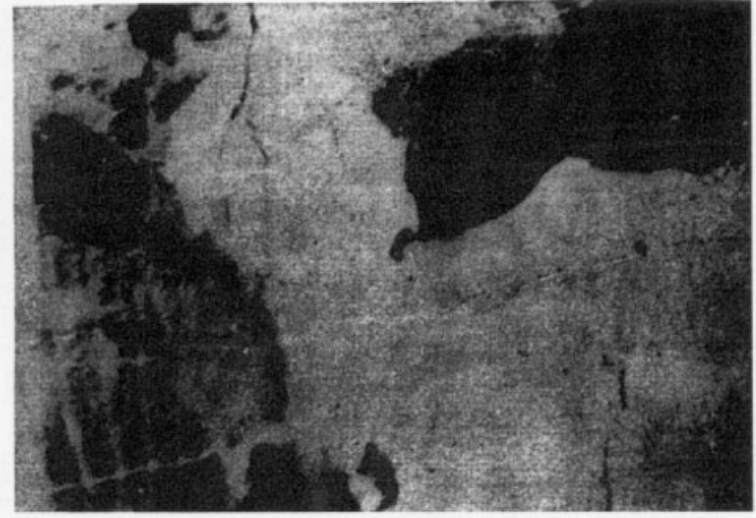

# A Bayesian account of visual contour completion

Look at the image before reading on. Which patches belong to the same object? Where would you draw its outline?



Now look for a **cow’s face**. Once one patch reads as a muzzle, the patches around it can fall into place as parts of the same head. What did the cue contribute if the pixels stayed the same? [Dallenbach’s cow puzzle (1951)](https://doi.org/10.2307/1419008)

**This project asks when top-down expectations help us recover a missing contour and when they lead us to invent one.** A related experiment made that change visible on paper. Participants drew the hidden regions of two-tone Mooney images before and after seeing the grayscale originals. Independent judges rated the later drawings as closer to the originals. [Lazarova et al. (2025)](https://doi.org/10.1111/tops.70018)

[Try the 50-trial browser experiment](https://thomylee2501.github.io/Bayesian-Interpretation-on-Visual-Contour-Processing/) · [Explore the computational notebook](computationalExperiments/face_completion/face_completion_counted_priors.ipynb)

## How evidence and expectation combine

How specific does the cue need to be? “Cow” suggests a familiar combination of features. “Muzzle nose” makes a claim about one part. Revealing the nose outline gives the observer a way to check that claim.

In the model, the visible pixels $I$ and the hints $H$ provide independent evidence given a candidate face $C$ and a known visibility mask $M$.

$$
P(C \mid I,M,H) \propto P(I \mid C,M)\,P(H \mid C)\,P(C).
$$

The **prior** captures which face recipes are familiar. The **image likelihood** scores how well each recipe predicts the visible strokes and visible background, allowing for noise. The **hint likelihood** accounts for what the observer was told and how reliable it is. Together they give a **posterior** over possible completions. If two recipes differ only behind the mask, the visible pixels give them equal support. Familiarity and hints can still favor one over the other.

## Testing the account with drawings

A recipe specifies head shape, ear shape, eye shape, eye spacing, nose shape, and the layout of the parts. Three options per feature give **729 possible faces**. The model learns feature frequencies from labeled cow-like, cat-like, and human-like drawings, then reconstructs held-out combinations from noisy fragments. We supply the feature vocabulary and the mask. How a viewer first groups patches of a photograph into a muzzle remains an open question.

In one controlled simulation, we gave two wrong nose hints per face on three held-out faces. The model’s most probable recipe adopted the hinted nose in **6 of 6** cases when the distinguishing pixels were hidden and **0 of 6** when they were revealed. This gives the human study a specific prediction to test. A small visible patch along the nose outline may matter more for judging nose shape than a large visible patch elsewhere on the face.

## The psychophysical experiment

Participants first see the 18 feature options and a typical face from each category. On each of **50 shuffled trials**, they choose six features to reconstruct a masked, noisy face. By default, they receive zero to six hints and a tally of how many are correct. After confirming, they see the masked image, their reconstruction, and the original side by side.

Accuracy is the number of features recovered out of six. Uniform guessing averages two. The session records the presented pixels, mask, hints, and each choice so the model and participant can be compared on the same trial. Feedback PNGs and the response CSV are saved locally. [Run the study](https://thomylee2501.github.io/Bayesian-Interpretation-on-Visual-Contour-Processing/) · [Browser source](https://github.com/ThomyLEE2501/Bayesian-Interpretation-on-Visual-Contour-Processing/tree/gh-pages)

## Where vector symbolic architectures fit

**Vector symbolic architectures (VSA) are a secondary hypothesis about how the visual system might represent and exchange evidence.** The Bayesian model already works by counting mismatches at visible pixels. The notebook tests a VSA alternative that assigns high-dimensional codes to pixel positions and approximates the mismatch score by the distance between two image vectors. Comparing the two posteriors measures what that encoding preserves and where it introduces error.

Full-candidate inference scores all 729 recipes. It produces a most probable drawing (MAP) and a posterior-mean image whose gray pixels show where plausible drawings disagree. Iterative inference approximates that calculation by updating beliefs one feature at a time. Running the same updates with ordinary or VSA-encoded messages isolates the effect of the representation. [Inference code](contour_models/vsa_inference.py) · [Hidden-eye control](outputs/baseline/eye_shape_control.png)

## Run the simulation

Open the [executed Jupyter notebook](computationalExperiments/face_completion/face_completion_counted_priors.ipynb) to inspect the figures. To rerun it, install the [requirements](requirements.txt) in a Python environment and run all cells. The first parameter cell controls visibility, noise, prior strength, and vector dimension. The [renderer and prior-fitting code](contour_models/face_recipes_and_observations.py) and [saved benchmark outputs](outputs/baseline/) are available separately.

```sh
python -m pip install -r requirements.txt
python -m unittest -v tests.test_face_completion
```
