# Daily project log

This log uses Pacific dates and has one section per day with a recorded project update. “You” are Thomy and “I” am Codex. The entries reconstruct the discussion from **Describe what you see**, its three project side chats, **Explain skipped MLE steps**, and **Inference Analogy Comparison**. Diagrams retain their original vocabulary. Links to experiment files open the most recent retained version.

## November 3, 2026 — Seeing the cow

**You asked** me to describe the image without searching the web, explain why a face came to mind, and consider whether feedforward evidence and feedback could account for recognition. You asked for a notebook where you could change how strongly a prior influenced the contours drawn into a gap.

**I did** identify a cow facing the viewer. The pale central strip, flanking dark patches and broad lower muzzle supported that reading. We worked from that observation toward a synthetic experiment in which the true missing strokes would be known. I started building the notebook that evening.

**What needed an ELI5 explanation.** What does a “role” do, and how could a dot product mean uncertainty? Think of a role as the label on a slot, such as *nose shape*. Binding keeps a feature attached to that slot. For a bipolar key $r$, multiplying by $r$ twice undoes the binding because each entry squares to one. Several proposed shapes can agree with the same patch. Turning their similarities into probabilities requires a model of how variable or noisy the evidence is.

**Your new ideas and questions.** You proposed recovering several factors within a single bound part, such as shape, color and position relative to the eyes. Your motivating observation was behavioral: once people recognize the cow, their sketches can gain contours that the photograph never explicitly supplied. Would a model invent those contours too?

**My clarifications.** The cow description gives visual reasons for an interpretation. It cannot establish the internal sequence by which recognition happened. A model should allow uncertainty to remain high when multiple explanations fit. A confident guess alone would be a poor test of closure.

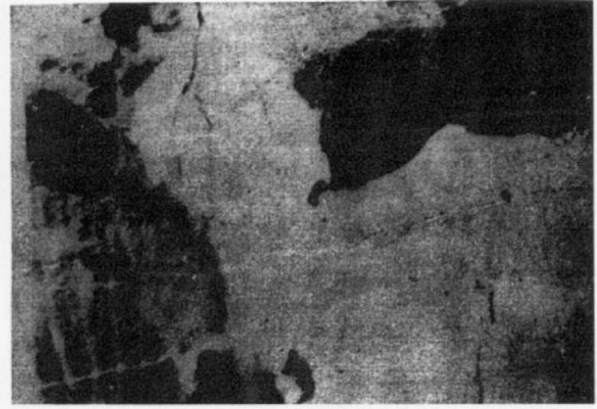

Your reference diagram for the question about feedback between levels:


## November 4, 2026 — First runnable experiment

**You asked** me to push the notebook and supporting files to the GitHub repository you specified, initially private.

**I did** finish and execute the first notebook after midnight. It varied visibility, pixel noise, prior strength and vector dimension. It compared exact-pixel and VSA evidence, included a misleading-cue condition and tested genuinely open contours. After you completed sign-in, I pushed it to the private repository. [Current baseline notebook](https://github.com/ThomyLEE2501/Bayesian-Interpretation-on-Visual-Contour-Processing/blob/dd52ae9cfbb52e443c931c747206816a57466ff9/vsa_gestalt_closure.ipynb)

**What needed an ELI5 explanation.** No new conceptual question was recorded during the repository handoff. The first experiment gave the sketch question two separate scores. Filling a hidden stroke earns credit if a stroke really belongs there. Drawing across a truly empty gap counts as an invention. One reconstruction can do both.

**Your new ideas and questions.** You chose private access for this stage of the project.

**My clarifications.** The model received a mask showing where evidence was missing, a vocabulary of possible parts and a renderer that could draw them. Results on those synthetic images answered a narrower question than recognizing the original photograph.

The main chat illustrated this comparison with a completion panel. This is the retained version using the current face vocabulary.


## November 5, 2026 — What the model learns before seeing a fragment

**You asked** how training worked, whether VSA did the training, and for a plain-language walk through the layout, category and exemplar priors in `fit_priors()`. In a related chat you connected the face experiment to maximum a posteriori estimation (MAP).

**I did** trace the code from training feature rows to one prior score per possible drawing. We separated the drawings used for fitting from the combinations held out for reconstruction. [Baseline implementation](https://github.com/ThomyLEE2501/Bayesian-Interpretation-on-Visual-Contour-Processing/blob/dd52ae9cfbb52e443c931c747206816a57466ff9/closure_model.py)

**What needed an ELI5 explanation.** Imagine a pile of recipe cards. A layout prior counts how often arrangements occur. A category prior counts how often each ingredient occurs within a group such as cow-like faces, then can mix across groups. An exemplar prior asks how closely a recipe resembles whole training examples. A uniform prior gives every recipe the same starting weight. Adding a small count to every option keeps an unseen option possible.

**Your new ideas and questions.** You recognized that the experiment asks which face is plausible *after* seeing its fragment. Could fitting parameters by maximum likelihood and choosing a drawing by MAP both belong in the same experiment?

**My clarifications.** Yes. Model fitting and choosing a test drawing answer different questions. MAP chooses the recipe maximizing likelihood times prior. The full posterior also tells us how much probability its competitors retain. In the original fitter, training used supplied feature values. VSA entered when scoring image evidence or passing feature messages.

## November 6, 2026 — From a recipe table to a top-down message

**You asked** what a candidate was, how the scoring rule was learned, what `samples[:, 5]`, `states[:, j]` and `normalize_logp` did, and whether the bank of priors changed at test time. You asked especially how the other features could influence a guess about the nose.

**I did** follow one candidate through counting, indexing, normalization and inference, and drew the two routes from shared evidence to a predicted stroke.

**What needed an ELI5 explanation.** Each row is a face recipe. Column $j$ lists one feature for every face. Counting a training column makes a lookup table. Reading that table with the candidate column gives each face the score for its own value. Given log scores $s_i$, subtracting $\log\sum_k e^{s_k}$ makes the exponentiated scores sum to one. During a trial the model keeps the learned table fixed and updates its beliefs about this face. A nose gets more support when it goes well with the ears and head that currently look plausible.

**Your new ideas and questions.** You connected the image score to a likelihood and saw why adding log prior and log likelihood gives a posterior score. You then asked where VSA contributes to each of those computations.

**My clarifications.** The renderer draws pixels from a recipe. Inference works back toward plausible recipes by comparing drawings with the visible marks. Full-candidate inference normalizes scores over complete faces. Iterative inference updates feature distributions using the current beliefs about the other features.

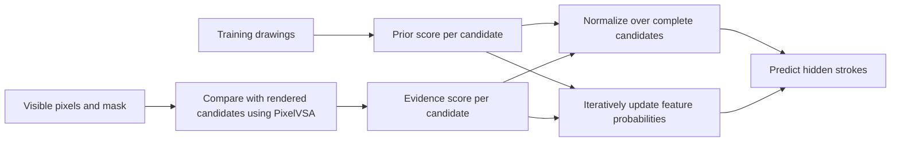

## November 9, 2026 — What changes when someone says “cow”?

**You asked** for a 15-slide presentation, the axes and missing dense curve on the convergence plot, and an explanation of how full-candidate and iterative inference relate. In the side chats you asked about masks, cross-talk, softmax, feature dependence, unbinding, sparse memory and the breadth-first/depth-first analogy.

**I did** build the deck and revise slide 12 so the nearly overlapping curves could be read. The horizontal axis counts sweeps through all six features. The vertical axis shows variational free energy in nats. The final dense and VSA values were about 81.804 and 81.900. I also drew a proposed recurrent encoder. [Revised presentation](presentation/VSA_Contour_Completion_revised.pptx)

**What needed an ELI5 explanation.** A white pixel you can see rules out a black stroke there. A hidden pixel tells you nothing either way, so it needs a separate mask. Full-candidate inference gives every complete recipe a score and uses softmax to turn those scores into probabilities. Iterative inference keeps several possibilities alive per feature and revisits them. If seeing a muzzle increases belief in a cow-like category, ears common in that category can gain support too.

**Your new ideas and questions.** What happens if the visible muzzle has a shape the renderer cannot draw? Would adding more and more predefined recipes just move the scalability problem? You identified the original target more precisely: a “cow face” cue might change how the *same marks* are grouped. You asked whether a learned encoder or associative memory could recover that structure directly.

**My clarifications.** Both inference methods use the same learned prior and image scores and produce separate answers. The full-candidate result does not prune the iterative search. This implementation still consults the recipe table for its iterative updates. “Exhaustive scoring” and “repeated feature updates” describe the computations more precisely than tree-search terminology. A cue-conditioned encoder was a proposal for a different experiment.

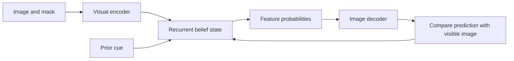

## November 10, 2026 — Making cues visible and learning priors online

**You asked** me to fix notebook math delimiters, preserve block masks, keep the notebook builder locally, and investigate why the example face looked perfect under every cue. You asked me to try different seeds, visibilities and prior weights. In parallel, you requested a pipeline diagram and a local copy for supervised and label-free Hebbian learning.

**I did** verify that the posterior was recomputed for each cue. I increased the precision of its display and found an illustrative mask with seed 67. A target visibility of 47% revealed 62.5% of this particular image. With cue strength 3, correct and wrong cues produced different eye spacings despite equally good visible fits. I kept the 0–24 sweep. In the learning copy, one-pass supervised Hebbian learning reproduced the batch-count result at matching settings. The competitive notebook compared three training seeds and recorded how often each unit was used. [Supervised notebook](https://github.com/ThomyLEE2501/Bayesian-Interpretation-on-Visual-Contour-Processing/blob/dd52ae9cfbb52e443c931c747206816a57466ff9/hebbian_learning.ipynb) · [Competitive notebook](https://github.com/ThomyLEE2501/Bayesian-Interpretation-on-Visual-Contour-Processing/blob/dd52ae9cfbb52e443c931c747206816a57466ff9/competitive_learning.ipynb)

**What needed an ELI5 explanation.** A printed probability of 1.00 can hide a value such as 0.99999954. A mask can reveal enough distinctive marks to identify one recipe among 486. For supervised Hebbian learning, a category and its observed features are active together, strengthening their connections. With competition, several anonymous units respond and the more active ones learn more from that face.

**Your new ideas and questions.** Could the demonstration keep the fragment recognizable to a human while leaving one feature genuinely ambiguous? Could category preferences emerge without supplying the category names?

**My clarifications.** The chosen seed illustrates a mechanism. The sweeps test how often it appears. Removing category labels still leaves supplied feature values and a chosen number of units. In your pipeline sketch, the original vocabulary had 486 candidates, and both the observation and every candidate must receive the same mask before encoding.

Your full-candidate sketch and the companion iterative diagram from the side chat:


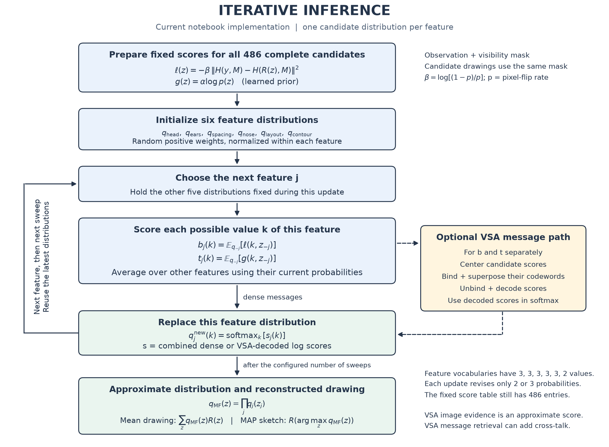

[Scalable vector version of the iterative diagram](diagrams/iterative_inference_pipeline.svg)

The main chat also showed the same fragment under different category cues. The current version of that figure is below.


## November 11, 2026 — What “label-free” leaves in place

**You asked** what a local geometric prior would learn and whether the competitive Hebbian model already learned from pixels.

**I did** compare the inputs of the two approaches. The implemented learner sees a row of supplied properties, such as ear shape and nose shape. The proposed geometric learner would see local edge measurements and their positions.

**What needed an ELI5 explanation.** Imagine two short pencil marks separated by a gap. Their directions and relative positions can make a smooth continuation plausible before you know what object they belong to. Learning that relationship would require the model to detect the marks and represent their relative geometry.

**Your new ideas and questions.** If neither approach requires a “cow” label, what would the proposed version add?

**My clarifications.** Category labels and feature descriptions are different kinds of supervision. The competitive learner can discover that supplied features tend to occur together. Learning where a feature begins and ends in the image is a further problem.

## November 12, 2026 — Associative memory and factor recovery

**You asked** us to keep the terms *renderer* and *generator* consistent, explain supervised Hebbian learning, and choose between implementing pixel-based geometry or a Hopfield exemplar prior. You chose Hopfield and asked where a resonator would fit in a future system.

**I did** add and execute the Hopfield notebook. It learns pairwise associations among feature values, scores complete recipes by energy, and separately tests retrieval from partial feature cues. I drew the three pipelines below. [Hopfield notebook](https://github.com/ThomyLEE2501/Bayesian-Interpretation-on-Visual-Contour-Processing/blob/dd52ae9cfbb52e443c931c747206816a57466ff9/hopfield_learning.ipynb)

**What needed an ELI5 explanation.** In supervised Hebbian learning, a supplied label tells the model which unit is active while a feature appears. The co-activity rule still determines the weight change. In a Hopfield memory, combinations of features that fit learned associations can settle into low-energy states. A probability proportional to $e^{-\beta E}$ gives a lower-energy recipe more weight. Clamping a known feature is like holding one puzzle piece in place while trying the others.

**Your new ideas and questions.** Can a resonator recover shape, width and position from one bound vector? Can we tell whether an error came from encoding an image or from factorizing its code?

**My clarifications.** A resonator needs a suitable vector from an encoder. Testing it first on a known bound vector, then a complete image, then a masked image would separate those failure modes. Hopfield retrieval can settle on a wrong or novel combination. The diagram’s 17 units describe the original vocabulary. The current six three-way features use 18 units.

*Proposed encoder and resonator*

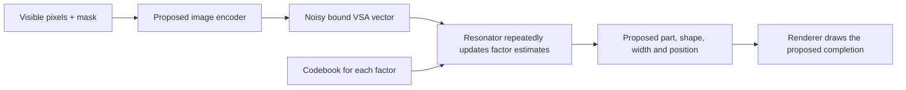

*Implemented supervised and competitive Hebbian priors*

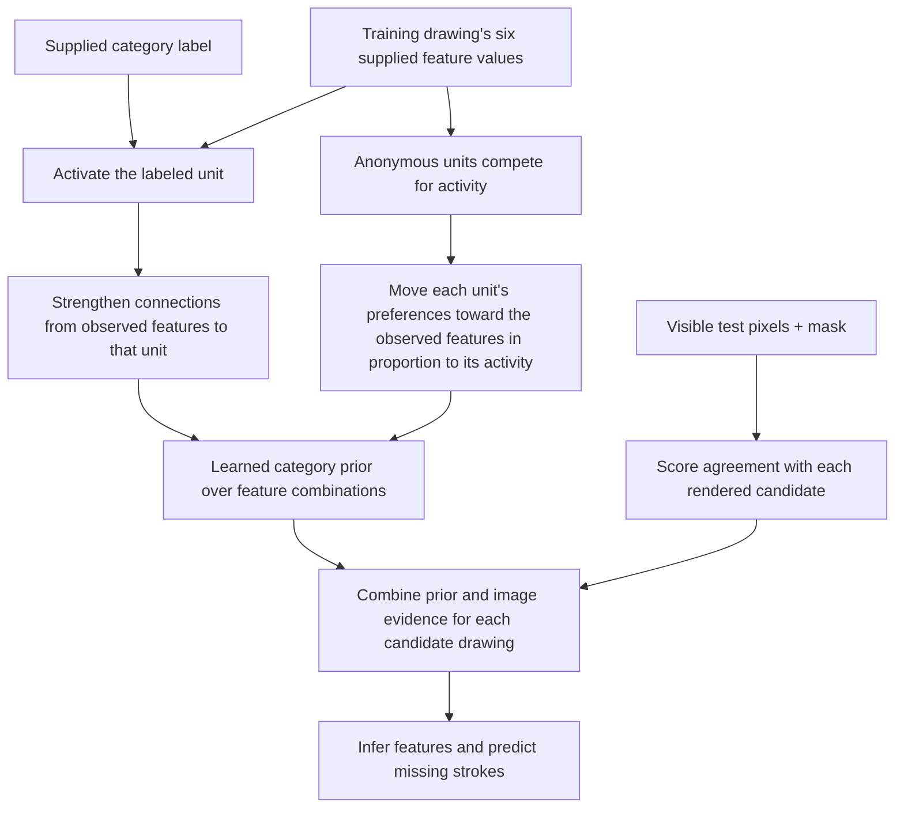

*Implemented Hopfield prior and partial-feature retrieval*

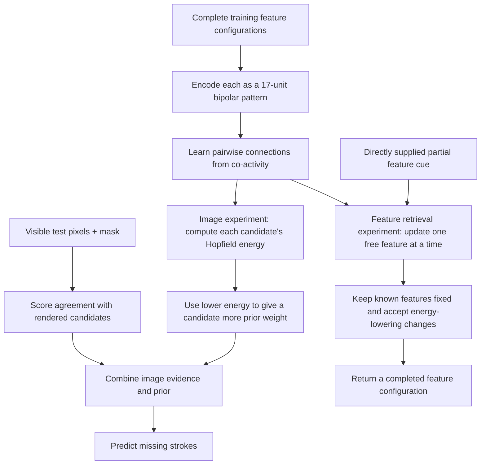

## November 13, 2026 — Testing what a cue changes

**You asked** where the model used near-orthogonality in high dimensions, what exactly we would swap in a cue-conditioned encoder test, and whether the current experiment already did that comparison. You also asked for multiple seeds and visibilities, feature-specific cues beyond eye spacing, and a LaTeX writeup that began with definitions.

**I did** run 27 seed/face/visibility cases and 24 comparisons targeting nose, ears, head shape or layout. In those deliberately concealed cases, wrong hints changed the target in 6/6 nose, 6/6 ear, 6/6 head-shape and 4/6 layout comparisons. Revealing the distinguishing pixels reduced each count to 0/6. I wrote up the counted-prior experiment. The retained [writeup](writeup/closure_experiment.pdf) includes its later revisions.

**What needed an ELI5 explanation.** Nearly perpendicular random codes can be added without drowning one another out. That helps estimate pixel mismatch and read back feature scores. The proposed *swap* tests something else: save two interpretations of exactly the same strokes, one formed with a cow cue and one without. Feed each saved interpretation to the same neutral completion stage. If the output changes, the difference traveled through the saved encoding.

**Your new ideas and questions.** Could we compare a cue that only changes which recipes seem likely with one that changes how visible marks are grouped? If the encoder already expresses grouping, must the comparison still happen in pixels?

**My clarifications.** The existing model can change $p(z\mid c)$, the prior over recipe $z$ given cue $c$, while keeping its image-match score fixed. The proposed model adds a grouping that can itself depend on the cue. A renderer remains useful for checking a reconstruction against the marks, but an internal grouping comparison can also be measured directly. The swap below is an experimental design.

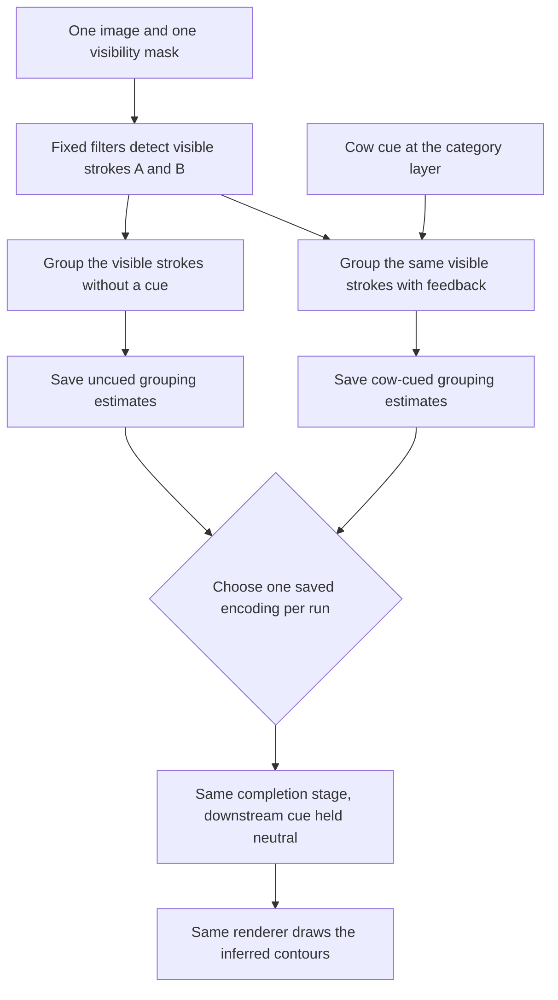

## November 15, 2026 — Why give a pixel both a value and a role?

**You asked** what $r_{\rm pixel}$ contributes when $y_{uv}$ already says what is at row $u$, column $v$. You also asked whether zero is black or white, and why the code uses 0/1 when its vectors use −1/+1.

**I did** work through the encoding and the effect of changing conventions. [Image encoder](https://github.com/ThomyLEE2501/Bayesian-Interpretation-on-Visual-Contour-Processing/blob/dd52ae9cfbb52e443c931c747206816a57466ff9/vsa_inference.py)

**What needed an ELI5 explanation.** In the drawings, 1 means a black stroke and 0 means white background. The pixel value says how much to add. Row and column codes say where. A role code says what kind of information is being stored. Multiplying every candidate and observation by the same bipolar role preserves their distances. With the same mask, switching pixel values to $2y-1$ doubles each difference and multiplies squared distance by four.

**Your new ideas and questions.** Would role labels become more valuable if an encoder stored features or stroke groups as well as pixels?

**My clarifications.** Distinct roles would let the same representation carry several kinds of information that could be queried separately. With the present single pixel role, one shared sign change per vector coordinate preserves the comparison. If the image convention changed, dividing the distance coefficient by four would preserve its contribution to the score.

## November 16, 2026 — Eye shapes, mixed hints and the poster

**You asked** to replace open/closed outline with three eye shapes, make dots characteristic of cows, oval pupils of cats and arches of humans, and rerun the comparisons. You also asked to mix correct and wrong feature hints, save the faces, and start a 24 × 36 inch poster with the cow, a neuroscience introduction and a simulation summary.

**I did** update the renderer to six three-way features, giving $3^6=729$ recipes. I reran 27 visibility cases and 30 targeted-cue cases. Wrong eye-shape hints changed the MAP eyes in 6/6 concealed cases and 0/6 revealed cases. I tested eight correct/wrong patterns across ear, eye and nose hints plus an uncued baseline. The saved output includes both MAP and posterior-mean faces at five weights. I also built the poster introduction and discussed the feedback interpretation of the drawing study you identified. [Targeted cues](outputs/targeted_feature_cues_2026-11-16/targeted_feature_cues.ipynb) · [Mixed cues](outputs/mixed_feature_cues_2026-11-16/mixed_feature_cues.ipynb) · [Visibility runs](outputs/seed_visibility_runs_2026-11-16/seed_visibility_results.ipynb)

**What needed an ELI5 explanation.** An earlier targeted trial gave one hint at a time. Saying “arched eyes” changes one feature’s score. Saying “arched eyes, long ears, muzzle” gives three pieces of evidence which may agree or conflict. A MAP face is one complete recipe. A gray area in the posterior-mean face shows where plausible recipes draw different strokes.

**Your new ideas and questions.** Would contradictory hints create more informative plots? Did the neuroscience paper identify a mechanism for the change in people’s drawings after disambiguation? What does scene context in a hidden region of V1 mean?

**My clarifications.** The V1 discussion concerned activity in the cortical region corresponding to a hidden part of the image. The paper discussed recurrent feedback as an explanation and used the full grayscale image for disambiguation. Its drawing result leaves open which computation groups the patches. The cartoon experiment supplies its own feature vocabulary.


## November 17, 2026 — Giving people the same reconstruction task

**You asked** for contour plots of recovery against visibility, correct hints, noise and prior strength. You wanted a 50-trial interactive study that saved each six-feature response, feedback and a CSV. You requested adjustable semantic hints, disclosure of how many were right or wrong, a logarithmic visibility option and colors that reflected chance performance.

**I did** build the desktop slideshow, feature guide, session recorder and plotting tools. The model sweep compared each prior weight against zero on the same faces and fragments. At $\alpha=12$, the MAP recipe changed in 95% of matched cases at 10% requested visibility and 39% at 70%. Average recovery decreased at both endpoints. I updated the poster for the new feature set. [Study and analysis guide](psychophysicalExperiment/README.md) · [Prior-effect results](outputs/psychophysics/accuracy_contours/prior_effect.csv)

**What needed an ELI5 explanation.** Guessing one of three choices gives an average of $1/3$ correct per feature. Across six features, the expected score is $6/3=2$. An individual trial still has a whole-number score from zero to six. A higher prior weight can change the chosen face often while making it less accurate. “The prior mattered” and “the prior helped” require different measurements.

**Your new ideas and questions.** Could we give a participant anywhere from zero to six hints, tell them the total number correct, and leave them to decide which features to trust? Would stretching the low-visibility axis reveal changes concentrated there?

**My clarifications.** With a disclosed tally of $k$, a proposed face must match exactly $k$ hints under the study’s generation rule. With the tally hidden, each hint contributes according to its assumed reliability. Holding the number of supplied hints fixed makes the effect of hint correctness easier to interpret.

## November 18, 2026 — A usable desktop and browser study

**You asked** to use the full screen, enlarge feature choices, revise the instructions and display actual visibility. You wanted the study in its own folder and a browser version that saved feedback and responses locally.

**I did** revise the desktop layout and organize the study under `psychophysicalExperiment`. I published the static browser version after you made the repository public. At the time, I tested a complete 50-trial browser session, folder and ZIP saving, and Python replay of the export. [Browser files](psychophysicalExperiment/web/) · [Desktop launcher](<psychophysicalExperiment/Start face study.cmd>)

**What needed an ELI5 explanation.** No separate theory question was recorded. One interface distinction mattered: if the generator aims to reveal a percentage of blocks, the particular trial can reveal a different percentage of pixels. The number printed below the image tells the participant how much of *this face* is visible.

**Your new ideas and questions.** Could participants choose their own save directory at setup and take the study without installing Python?

**My clarifications.** Browsers that support directory access can update the CSV and save feedback after each confirmation. The other workflow downloads a session ZIP. Saving each trial’s mask, pixels and hints lets the model replay the stimulus the person actually saw.

## November 19, 2026 — The first 50-trial pilot

**You asked** for interpretable computer-result graphics, a clearer explanation of “zero correct hints,” more readable example faces, analysis of Gary’s pilot and a README that put the Bayesian question first. You also asked for a short account of why a flexible encoder remained the goal.

**I did** choose and plot several reconstruction sets. You selected set 06: at 37.5% realized visibility the model recovered 3, 4 and 6 features with 0, 3 and 6 correct hints. In the first pilot, 13/50 trials fell below 20% visibility and the minimum was 4.7%. I changed the default schedule to allocate 5, 10, 20 and 15 trials to progressively higher visibility bands, added a configurable noise cap, and updated the study and README. [Selected faces](outputs/poster/Face_Recovery_Sets/Set_06_38pct_visible/)

**What needed an ELI5 explanation.** The computer figure supplied six hints every time. At zero correct, all six were wrong. The 2/6 chance line is what uniform guessing earns on average. A model with visible marks, nonuniform priors or hints can score differently even when one source of information is weak.

**Your new ideas and questions.** Would a contour plot show the changing influence of hints more clearly than four nearly overlapping lines? The pilot raised a design question too: how many severely masked trials can a person answer meaningfully?

**My clarifications.** The figure used $\alpha=12$ for the prior and $\beta=1$ for hint strength. The pilot’s noise trend was irregular across one session. The next study schedule changed, so later pooling needs to preserve that difference. Hebbian and Hopfield models explain how prior preferences could be learned. The flexible-encoder question concerns how seeing a cue might change which image fragments count as one part.

## November 20, 2026 — Comparing learned priors with human recovery

**You asked** for Tom’s analyses, pooled anonymous human results, and comparable computer plots using label-free Hebbian learning. You requested matched comparisons with Hopfield, pixel flips capped at 20%, an extra high-visibility run, six visibility bands, trend captions, a Hebbian equation on the poster, and a revised writeup.

**I did** assemble the final poster and update the paper for the 729-recipe renderer. Three results answer different questions:

- **Same 840 trials, 5% flip probability.** At prior weight 12, counting and supervised Hebbian both averaged 4.63/6. Competitive Hebbian averaged 4.58/6 across three seeds. Kernel exemplar fitting scored 4.89/6 and Hopfield 5.45/6, or 5.01/6 after matching its effective prior entropy to the kernel. With prior weight zero, the same evidence and hints averaged 5.50/6. [Matched comparison](outputs/prior_comparison/summary.json)
- **Five flip rates, 64 held-out faces per condition.** With 2–20% pixel flips, label-free Hebbian averaged 4.19/6 across the initial 10–70% target visibility sweep. The separate 80%, 90% and 95% runs averaged 5.56/6 together. [Capped-noise results](outputs/capped_noise_contours/run_summary.json) · [High-visibility extension](outputs/capped_noise_high_visibility/run_summary.json)
- **Two 50-trial pilots.** The second participant averaged 4.58/6. Pooling both sessions gave 4.17/6. Under your poster rule, two human trials with six correct hints and less than 15% visibility were excluded, giving 4.13/6 over 98 trials. All 100 confirmed responses are retained. [Final human plot data](outputs/poster/plot_data/human_scatter_data.json)

**What needed an ELI5 explanation.** Why could two contours look different with the same dots? A measured trial is one point. Coloring the space between points requires a rule for connecting them. With sparse data, two rules can color the same gap differently. The revised plot marks weakly supported regions. Fractional computer scores also have a simple origin: each face earns an integer from 0 to 6, then the figure averages across faces, hint conditions, training seeds or flip rates as applicable.

**Your new ideas and questions.** You wanted a fairer visual comparison across noise and visibility, questioned whether six disclosed correct hints made a low-visibility human trial trivial, and asked how flexible grouping could preserve the shape of an unusual contour. You chose the label-free prior for the poster’s computer panels.

**My clarifications.** Participants could use the hint-accuracy tally. The poster simulation received six hints with hidden tally and fixed reliability. The two human sessions also used different visibility schedules. Similar trends motivate a matched comparison, but these pilot averages alone cannot establish that people used the model’s update rule. The final paper keeps cue-dependent grouping as future work. [Poster](Poster/Bayesian_Visual_Contour_Poster_Hebbian_Rule.pptx) · [Writeup](writeup/closure_experiment.pdf)

The two contour images embedded in the final poster:


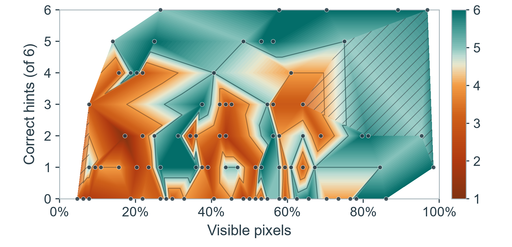

## November 21, 2026 — Establishing BayesContourProcessing

**You asked** to consolidate both model folders, keep the latest results and poster, recover the chat diagrams, and start a daily log at the cow image. You then asked to merge the two model folders, group their outputs and publish the consolidated directory as the repository’s main branch.

**I did** create this working directory, recover the diagrams and original comparison sketches, collect the latest saved runs and writeup, and reunite Tom’s archived trial files with his analyses. The copy passed the baseline model’s 27 tests and the learning variant’s 66 tests. I merged the implementations at the project root, preserved both full notebooks and their benchmark results, and moved the study sessions and poster plot data into [outputs](outputs/). [Project index](README.md)

All eight notebooks executed in an isolated copy, and all 66 distinct tests passed. The merged code matched the original code on all 1,107 rows of each model’s benchmark. The archived baseline CSV used the earlier dot-eye geometry and was reproducible with renderer version 1. The study replayed all 107 confirmed responses across the four saved sessions.

I connected this working directory to the existing GitHub repository and based its main branch on the previous main commit. The existing ignore rules keep raw participant sessions and the two full-notebook builders local.

**What needed an ELI5 explanation.** No new scientific explanation was requested today.

**Your new ideas and questions.** You designated this directory as the home for future project work and asked that the record reflect how your questions and understanding changed over time.

**My clarifications.** A repeated export is one session. Future entries belong under their Pacific calendar date, with additional work on the same day added to that day’s section.

## November 22, 2026 — Showing what a hint fixes

**You asked** for two faces under “Hint Tuning” in your revised 24 × 36 inch poster. One would show triangle ears in black and the other a tall face outline in black. You wanted the uncertain features in grayscale and both images sized to match the recovery candidates.

**I did** add the two equal-sized faces to a copy of your edited poster. Each image averages the 243 face combinations that satisfy its hint. I checked that both fit between the “Adjust” and “Infer” arrows. [Updated poster](Poster/Bayesian_Visual_Contour_Poster_24x36_Hint_Tuning.pptx)

I exported the [poster PNG](Poster/Bayesian_Visual_Contour_Poster_24x36_Hint_Tuning.png) at 200 dpi and added a Git ignore rule for new files in `Poster/Written_parts/`.

**What needed an ELI5 explanation.** Imagine stacking every drawing with triangle ears. The ears line up in every drawing, so they stay black. The eyes, nose, and other strokes move around. Where more drawings put ink in the same spot, the gray is darker. The tall-face example fixes the outline and varies the other features the same way.

**Your new ideas and questions.** You used the two hints to illustrate how a cue can specify one part while leaving the rest of the face open.

**My clarifications.** Gray shows how often a pixel appears when the compatible recipes are weighted equally. These are illustrations of hint information before the model scores the visible image or applies learned familiarity.

### Weighting the visual evidence

**Research question.** How much evidence for a face does a difference in encoded image distance provide? The revised writeup introduces a weight on the VSA score with the learned prior and hint reliability held fixed. The reported runs used visual weight one. The earlier prior-weight sweep, including α = 12, measures sensitivity to learned familiarity. [Writeup](writeup/closure_experiment.pdf)

**Completed comparison.** On the same 12 held-out faces, image evidence alone recovered 5.35 of six features on average. Adding hints at 50% assumed reliability gave 5.55, with exact recovery rising from 55.8% to 69.8%. The sweep varied the prior weight and assumed hint reliability across ten visibility levels and zero through six correct hints. It therefore answers a different question from fitting a visual weight. [Sweep](https://github.com/ThomyLEE2501/Bayesian-Interpretation-on-Visual-Contour-Processing/blob/dd52ae9cfbb52e443c931c747206816a57466ff9/sweep_hint_reliability.py) · [Summary](outputs/hint_reliability/summary.csv) · [Condition results](outputs/hint_reliability/by_condition.csv)

**What needed an ELI5 explanation.** Flattening an image keeps all its pixels. Counting disagreements summarizes one candidate comparison exactly under the independent flip model. Superposing pixels into 512 code coordinates adds cross-talk. Across random codebooks the squared distance has the right mean, while a particular pair of faces can look closer or farther apart.

**New idea and clarification.** The exact encoded likelihood sums the probabilities of visible images that produce the observed code. VSA retrieval theory and compressive imaging give related analytic results under their own noise assumptions. A proposed experiment would compare visual weights across code dimensions on separate calibration and evaluation images. The compression ratio alone does not determine the weight. The poster is deferred.

### Poster results and publication

The revised poster pairs the concealed and visible nose examples and reports exact face recovery with image evidence alone (56%) and with hints that were correct half the time (70%). The visibility-band and noise-rate plots now combine computer and human results. Orange and teal circles show computer condition means and human trials, respectively. Larger triangles show group means, and dashed quadratic curves summarize their trends. Both plots have boxed legends and align beneath the two contour plots.

At your request, I exported the current 24 × 36 inch poster at 200 dpi (4,800 × 7,200 pixels) and made the PNG the primary README poster link. This update presents existing results. The discussion of VSA distance and likelihood scaling remains a separate writing task. [Poster PNG](Poster/Bayesian_Visual_Contour_Poster_24x36_Hint_Results_Merged_Plots_Fitted.png) · [Editable PowerPoint](Poster/Bayesian_Visual_Contour_Poster_24x36_Hint_Results_Merged_Plots_Fitted.pptx)

### How much of a visible clue survives encoding?

You proposed treating a stroke as a continuous region. In your muzzle sketch, an outer boundary and two nostril holes belong to one region. You asked whether an encoder could bind each curve's shape to its position and whether the prior and a fallible hint could describe the same stroke while carrying different weights.

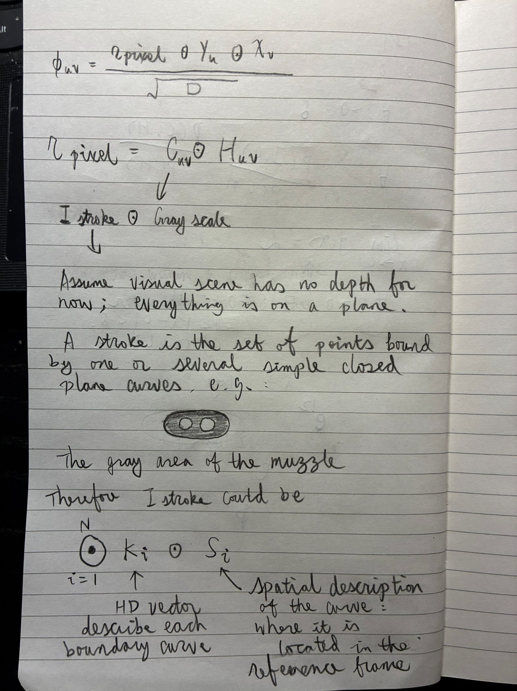

I reviewed prior work on inferring stroke programs, binding shape to position, completing contours with topology hints, and estimating likelihood ratios. The gap we identified is predicting when a visible clue should outweigh a hint after encoding, and whether that prediction transfers across image resolution, pixel type, and vector dimension. Section 8.5 records the question and the proposed test. [Writeup](writeup/closure_experiment.pdf) · [Stroke programs](https://arxiv.org/abs/2006.14448) · [VSA scene model](https://doi.org/10.1038/s42256-024-00848-0) · [Topology hints](https://doi.org/10.1109/CVPR.2013.246) · [Likelihood-ratio calibration](https://arxiv.org/abs/1506.02169)

**Plain-language example.** Suppose a hint says the long nostril is on the left. If the two sides were equally likely and the hint is right 80% of the time on either side, it gives left a four-to-one advantage. A glimpse of the right rim should change the answer only when it gives stronger evidence for right. The hint counts once across the whole stroke.

**Proposed computation.** Swap the nostrils, vary how much rim is visible, and compare the switch using exact pixel evidence, the existing pixel VSA, and a boundary-based VSA. Fit the calibration on one set of conditions and test it on held-out settings, including binary, grayscale, and color images. Copying pixels provides a control because it enlarges the image without adding evidence. The literature review is complete for this first pass. The encoder comparison remains to be run.

| Part of your proposal | Closest work and what it already delivers | What I would reuse |
|---|---|---|
| **Bind geometry, appearance, and placement into one scene vector** | **Renner et al. (2024)** is the closest architectural precedent. Their generative model represents a scene as a sum of bound vector products. A resonator network recovers factors including shape, color, translation, rotation, and scale from synthetic scenes. **Kymn et al. (2024)** also encode learned sparse image features into a hypervector and factorize it to parse the scene. | Start with Renner’s released notebook or PyTorch benchmark for the VSA comparison. Use Kymn as the reference if we replace hand-designed pixel codes with learned visual features. [Renner paper](https://www.nature.com/articles/s42256-024-00848-0) · [Demo notebook](https://doi.org/10.5281/zenodo.10810900) · [PyTorch benchmark](https://doi.org/10.24433/CO.1543398.v1) · [Kymn paper](https://arxiv.org/abs/2404.19126) |
| **Encode each boundary \(K_i\) and its relative position \(S_i\)** | **Zahn & Roskies (1972)** represented a closed plane curve by its accumulated turning angle along arc length and used Fourier coefficients to analyze and synthesize it. **Komer et al. (2019)** developed spatial semantic pointers for continuous positions, relative translations, and queries over regions of different shapes and sizes. | These give us concrete candidates for both \(K_i\) and \(S_i\). We can put the outer muzzle boundary and the two holes in a shared muzzle-centered frame. The relative displacement of the holes then survives translating the whole muzzle. [Closed-curve descriptors](https://www.cs.jhu.edu/~misha/Papers/Zahn72.pdf) · [Spatial semantic pointers](https://compneuro.uwaterloo.ca/files/publications/komer.2019.pdf) |
| **Infer strokes or recipes from an image** | **Feinman & Lake, ICLR 2021**, learned a prior over stroke programs and used a symbolic renderer and probabilistic inference to interpret handwritten characters. **CoSE, NeurIPS 2020**, learned fixed-size embeddings of variable-length strokes and modeled relations between strokes to complete drawings. There is a practical distinction: CoSE receives pen trajectories; our encoder receives masked pixels and must infer which fragments belong together. | Use Feinman & Lake as the image-to-program reference and CoSE as a comparison when the boundary curves are already supplied. The GNS repository includes model code, but its published inference path depends on a MATLAB parser. [ICLR paper](https://arxiv.org/abs/2006.14448) · [GNS code and dependencies](https://github.com/rfeinman/GNS-Modeling) · [CoSE paper](https://proceedings.neurips.cc/paper/2020/hash/723e8f97fde15f7a8d5ff8d558ea3f16-Abstract.html) · [CoSE models and code](https://eth-ait.github.io/cose/) |
| **Render recipes and recover filled regions from pixels** | **diffvg** provides a differentiable vector-graphics rasterizer. **LIVE, CVPR 2022**, fits layered vector paths to raster images with explicit attention to topology. A recent adjacent preprint, **Lang-SVG**, organizes inferred primitives into object–part hierarchies using segmentation and language priors. | Keep our renderer as the exact binary control. Use diffvg for antialiased grayscale and color renders, and LIVE as an image-to-path baseline. This gives us a way to test whether a recovered hole or boundary survives a rendering change before designing a new renderer. [diffvg and code](https://cseweb.ucsd.edu/~tzli/diffvg/) · [LIVE paper](https://openaccess.thecvf.com/content/CVPR2022/html/Ma_Towards_Layer-Wise_Image_Vectorization_CVPR_2022_paper.html) · [LIVE code](https://github.com/Picsart-AI-Research/LIVE-Layerwise-Image-Vectorization) · [Lang-SVG preprint, November 2026](https://arxiv.org/abs/2611.15941) |
| **Combine incomplete boundaries, prior shapes, and hints** | *Intrinsic Bayesian Active Contours* demonstrates prior-driven boundary recovery with partial obscuration. **Xu, Collins & Singh, CVPR 2013**, already combined contour completion with interior/exterior scribbles and a requested number of closed contours. That is particularly close to your “two nostril holes” example. **PHAC, CVPR 2026**, demonstrates prompt-controlled completion of occluded people. | Treat successful completion with a correct hint as an established result. The more informative comparison is what happens when a *fallible* hint conflicts with a small, diagnostic piece of visible boundary. [Bayesian active contours](https://pmc.ncbi.nlm.nih.gov/articles/PMC2980332/) · [Interactive completion with topology constraints](https://pubmed.ncbi.nlm.nih.gov/33994765/) · [PHAC](https://arxiv.org/abs/2603.14741) |

## November 23, 2026 — Organizing the code before the grayscale experiment

**You asked** to be able to tell what each Python file or notebook does from its name and folder. After making a backup, you approved the local reorganization and asked me to check every import. You asked to publish the progress log and to include your restatement of clarified intentions after my clarifications in future entries.

**I did** reorganize the local working copy. Face completion notebooks and parameter sweeps live in `experiments/face_completion/`. The notebooks that teach how each prior is learned live in `experiments/prior_learning/`. Shared implementations live in `contour_models/`, regression checks in `tests/`, and notebook builders and the execution tool in `tools/notebooks/`. The participant study keeps its existing folder with clearer script names. The three saved run notebooks stay beside their results. GitHub retains the earlier code layout for now. [Published code at the time of the reorganization](https://github.com/ThomyLEE2501/Bayesian-Interpretation-on-Visual-Contour-Processing/tree/dd52ae9cfbb52e443c931c747206816a57466ff9)

**Verification.** All 66 tests passed before and after the move. The exact-pixel and VSA posteriors for a fixed-seed face each matched their own earlier values byte for byte across 729 candidates. I checked the imports in all Python files and all eight notebooks, executed the five working notebooks in an isolated copy, and verified that all five builders reproduced their notebook's cell sources. The saved outputs stayed intact.

**What needed a plain-language explanation.** Two brightness values can land in the same gray bin. A stretch of boundary can then disappear even with every pixel observed. A nearby stretch with the same original contrast can remain visible if its two values straddle a bin boundary.

| Stage | Images | What we can test |
|---|---|---|
| **1. General grayscale scenes** | Generate overlapping curved regions, holes, shadows, and textured backgrounds. Vary contrast, blur, quantization, and noise independently. Keep the full image visible. | We know exactly which patches share a boundary. Test whether the encoder recovers their grouping on unfamiliar shapes and loses confidence when a diagnostic edge disappears. |
| **2. Paired photographs and Mooney images** | Give the encoder a two-tone image, first alone and then with a category cue. Reserve the source photograph for evaluation. A published resource already pairs 1,854 natural object images with Mooney versions, extending well beyond faces. [THINGS–Mooney study](https://doi.org/10.1038/s44271-026-00441-8) | Hold the pixels fixed and ask whether the cue improves a *specific, independently marked* boundary or patch assignment. The source photograph helps establish what to score. |
| **3. Natural photographs** | Use unaltered grayscale and color scenes with multiple human segmentations. [Berkeley Segmentation Dataset and Benchmark](https://www2.eecs.berkeley.edu/Research/Projects/CS/vision/grouping/resources.html) | Test where the encoder’s groupings agree with observers and whether it retains competing interpretations where observers disagree. |

**Your new ideas and questions.** You proposed using continuous spatial coordinates for measurements and letting the encoder infer which fragments belong to the same stroke. You want to move from generated grayscale scenes toward Mooney images and natural photographs. The first grayscale experiment is planned.

**My clarifications.** Supplying a rule that allows two fragments to share a boundary leaves their actual membership for the model to infer. We can hold the source scene fixed, change the gray bins, and measure whether a hint helps the model recover a boundary that the hint never identified.

**You restating your clarified intentions.** You want to test ambiguity caused by discretizing grayscale. Distinct brightness values can become the same input value, with the original contrast held fixed. The encoder should work beyond animal faces and accept fully observed images. Before building that experiment, you wanted the code organized locally and its imports verified.

## November 24, 2026 — Started building the grayscale experiment

### Notes to Thomy for tweaking render params

**How is the scene sampled**: 

A seeded scene is sampled by `sample_scene`. The seed makes the same scene reproducible. It randomly chooses:

- Center: x and y each from about 0.43–0.57; orientation: 0–π.
- Two lobe radii: about 0.103–0.144; half-spacing: 0.18–0.205.
- Bridge width: 0.027–0.043; bend: −0.045 to 0.045.
- Light direction and two spot locations/sizes.

The geometry and lighting are constructed in `render`. In rotated coordinates, the lobes are disks centered at `u = -d` and `u = +d` (`shape definition`). The bridge is a band between them, centered on a slightly curved midline (`bridge definition`). The “separated” image uses just the lobes; the “joined” image uses the lobes plus the bridge. Both use the same sampled scene.

Brightness starts at 100, with uniform, diagonal, rotated, or local-spot illumination (`lighting fields`). The shape adds `7 × coverage` gray levels—the contrast is set in `run_grouping_experiment.py`. So fully covered pixels get +7 before quantization, while boundary pixels get a fractional increase due to supersampling.

**How do I configure the lights in the "local condition"?**

In the notebook, `("local", 0)` selects the local-light field, but the light positions and sizes are generated by `sample_scene(SEED)`. Because the seed is fixed, they stay the same between runs. The local field starts at gray level 100 and adds two Gaussian spots: the first bright, the second dark. Their positions `(cx, cy)` and size `sigma` are in normalized image coordinates from 0 to 1. See `sample_scene` and the `local-light calculation`.

To set their positions and sizes explicitly in the notebook, replace the scene’s `spots` before calling `render`:

```python
from dataclasses import replace

scene = sample_scene(SEED)
scene = replace(scene, spots=((0.30, 0.45, 0.12), (0.72, 0.55, 0.16)))
separate, joined, fields = render(
    scene, SIZE, settings["samples"], 20, spot_amplitude=14
)
```

`spot_amplitude` controls how strong both spots are; the first adds that amount and the second subtracts it. The `20` is the gradient span and does not change the local-light field.

### First image-only recovery results

**You asked** to test whether two lobes belong to one continuous region as grayscale quantization makes parts of the connecting bridge disappear. The encoder sees one fully observed image per trial. It receives no cue, mask, or reference drawing.

**I did** run the experiment with 32 training geometries, 16 separate calibration geometries, and 24 held-out geometries. The same test scenes were rendered at 64, 128, and 256 pixels per side. At 128 × 128, the 256-dimensional VSA correctly classified 69.9% of 2,304 images across the lighting and bin settings. Accuracy was 85.9% on the 1,276 images whose joined and separate renders differed, and 50% on the 1,028 images whose renders were identical. On those identical pairs the encoder still gave its chosen answer 58.8% confidence on average. That leaves a measurable calibration error. The eight geometric measurements alone reached 69.5% overall, close to the VSA result. The notebook ran end to end, and all 69 tests passed at the time of the run.

**What needed a plain-language explanation.** In the same 128-pixel scene under the same diagonal light, moving the gray-bin boundary changed how much of the bridge could be seen. At offset 4, 15 of 40 sampled crossings along its edge survived. At offset 12, all 40 disappeared. Part of a lobe remained visible, yet the joined and separate drawings produced exactly the same input.

**Your new ideas and questions.** You proposed varying where the scene is bright or dark so that different stretches of one contour blend into the background. The diagonal ramp and local bright and dark spots put that idea into the first experiment.

**My clarifications.** The simulator knows whether it drew a bridge. Once quantization makes both recipes produce the same pixels, an image-only encoder must give both images the same prediction. With the two recipes equally likely in that pair, 50% is the reference confidence.

**You restating your clarified intentions.** You wanted the original scene and its contrast held fixed while nearby brightness values fall into the same gray bin. You added uneven illumination so that a contour can be partly visible, and asked to begin with the generated scenes before moving on to Mooney images.

Local experiment files: [Executed notebook](computationalExperiments/recovery_from_grayscale_quantization/recovery_from_grayscale_quantization.ipynb) · [Paired scenes and surviving contours](outputs/recovery_from_grayscale_quantization/illumination_and_contours.png) · [Held-out results](outputs/recovery_from_grayscale_quantization/held_out_summary.csv).

### How Thomy wants to change the scene config implementation:

"I checked your implementation and there are a few things I'd like to change. Let's start with the lobes and bridge(s) (which in the following discussion I would call signal) setup. I'd like to make this more flexible and allow for manual setups. Instead of a single center coordinates, I would like for it to be a list of the coordinates of the local "origin" of the reference frame that describes each signal component shapes. So it would be something like centers = [(x_lobe1, y_lobe1), (x_lobe2, y_lobe2), ...]. The shapes of lobes will not be fixed as "((u+d)**2 + v**2 <= scene.radii[0]**2)" in the render function, but defined by a separate function parametrizing closed curves based on the centers[i], with the circle as default. Likewise with bridge bending. Default setup to 2 lobes and one bridge, but allow configuring multiple lobes and bridges, as long as #bridges < #lobes. Not every lobe needs to be connected to one other lobe. Refer to https://fa24.datastructur.es/projects/proj3 for inspiration: connecting lobes and bridges should be similar to connecting rooms and hallways. I would also like for the signal brightness to be adjustable. From what I understand, it is currently set as uniformly 7 levels above background mean. The signal should be allowed to be darker than the background mean. I would like this scene config to be available as a function in the notebook that the if MANUAL_SET_SCENE can call, for a more intuitive UI."


### Manual signal geometry and brightness

**You asked** for a notebook control that lets you place each lobe, draw its outline in its own coordinates, and choose which pairs to bridge. Your rooms-and-hallways example allows an isolated lobe even when other lobes connect.

**I did** add `manual_scene()` under **Set up the signal**. It starts with two circles and one bridge. Each lobe accepts a circle, an ellipse, or a custom closed curve. Each bridge specifies two lobe indices, a width, and a bend profile. The number of bridges must be smaller than the number of lobes. A four-lobe preview with two bridges left one lobe isolated. The original seeded renders matched pixel for pixel across five seeds at three resolutions, and all 73 tests passed. [Experiment notebook](computationalExperiments/recovery_from_grayscale_quantization/recovery_from_grayscale_quantization.ipynb)

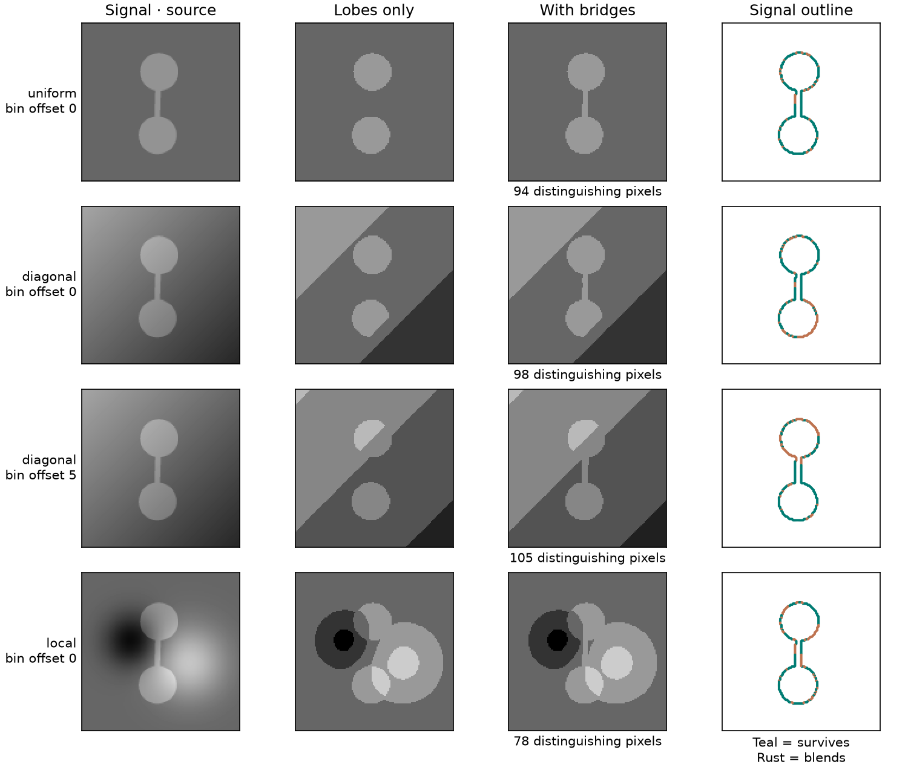

**What needed a plain-language explanation.** Brightness follows the local illumination. With `signal_offset=-7`, a fully covered pixel over a background value of 100 becomes 93 before quantization. At the same position, a half-covered pixel becomes 96.5.

**Your new ideas and questions.** You proposed varying shape and connectivity independently so that placing a lobe does not automatically connect it to its neighbor.

**My clarifications.** The manual preview compares one layout with its listed bridges present and absent. The saved held-out accuracy measures recovery on the seeded two-lobe benchmark. The dark four-lobe example checked the renderer and preview.

**You restating your clarified intentions.** Your design note above asks to keep two lobes and one bridge as the starting point and to make local shape, connectivity, and signed brightness editable in the notebook.

## November 25, 2026 - Independent grayscale fields for the signal and background

**You asked** to design two complete brightness fields in the scene editor. Your sketch shows a lobe-and-bridge footprint cut from a striped signal field and pasted onto a separately shaded background.

<details>
<summary>Original design sketch (available in the local review copy)</summary>


</details>

**I did** add the same four choices to both layers in `manual_scene()`: uniform, an oriented linear ramp, periodic stripes superimposed on a ramp, and one to five local spots with individually signed strengths. The notebook displays the full background, the full signal, and the composite before quantization. The manual example uses a background baseline of 100 and a signal baseline of 107. A reproducible random option samples both fields. All 77 tests passed. The notebook ran end to end, and the random-field and shared-illumination preview modes were also exercised.

**What needed a plain-language explanation.** The signal offset sets its baseline. For an offset of +7 and stripe amplitude 14, the signal spans 93 to 121. Within a single lobe it can cross from darker than the surrounding surface to brighter. The outline diagnostic uses the local contrast direction at each crossing.

**Your new ideas and questions.** You proposed controlling stripe width and phase independently of grayscale bin width and offset. That makes it possible to move a stripe across a fixed bridge before discretizing the image.

**My clarifications.** The periodic option uses a sinusoid. Band width is the distance from a trough to a peak, and a full cycle spans two bands. The cropped field replaces the background wherever the geometry fully covers a pixel. Fractional coverage mixes the two intensities at the edge before quantization.

**You restating your clarified intentions.** You specified that the signal should first fill the entire 128 by 128 field. Only the pixels belonging to the signal geometry should appear on top of the background.

The local writeup now follows one held-out geometry through the region encoder and the 64- and 256-coordinate VSA readouts in Section 8.6. Figure 6 shows where quantization or component filtering erases the bridge evidence. Section 8.7 and Figure 7 document the new layer controls and a rendered example. Held-out performance on independently patterned layers has yet to be measured. The code, sketch, figures, and revised writeup are local for review.

### Posterior credibility of a bridge-width hint

The posterior belief in the hint’s claim is already in $P(C\mid I,H)$. What’s missing is a symbol for the claim itself. The left-hand side asks “Which contour is present?” You’re asking “How much probability do I now give to the contours for which this hint is true?” Annotation 1

Take your example. The viewer hears “same bridge width as before.” Call that message $h$, and let $A_h$ be the set of candidate contours whose bridge has the reference width. Then the credibility you mean is exactly

$$
\boxed{
P(\text{hint's claim is true}\mid I,H=h)
=\sum_{c\in A_h}P(C=c\mid I,H=h).
}
$$

If there are only two candidates, familiar width and wider, the sum has one term. The posterior probability of the familiar width is the posterior credibility of the hint. If ten different contours have the familiar width, their probabilities add. The viewer can be confident about the width while remaining uncertain about the rest of the contour.

We can also write your question as a Bayesian update in its own right. Let $T$ mean “the bridge has the reference width.” Then

$$
P(T\mid I,H=h)
=
\frac{P(H=h\mid T,I)\,P(T\mid I)}{P(H=h\mid I)}.
$$

Read it in order: after seeing the image, how plausible is the familiar width? That’s $P(T\mid I)$. How much should hearing “same width” revise that belief? That depends on how likely the source would be to say it when $T$ is true versus when $T$ is false.

## November 26, 2026 - A two-tone pelican

**You asked** to try the grayscale pipeline on realistic faces and then publish the stages that produced the pelican puzzle. [View the puzzle before the reveal](outputs/grayscale_animal_faces/pelican_demo/quantized.png).

**I did** prepare eleven local subjects: ten generated animal portraits, including one bullfrog and one snake, plus Oski cropped from your photograph. Four background patterns, three brightness baselines, and two compositing methods gave 264 unquantized images. Four bin widths and four phases per width gave 4,224 quantized images. The pelican demo starts from its original transparent portrait and reproduces all 16,384 pixels of the selected image. [Reproduction and batch script](computationalExperiments/recovery_from_grayscale_quantization/make_animal_face_stimuli.py)

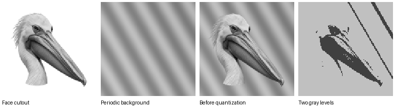

**What needed a plain-language explanation.** The background's diagonal stripes exist before the pelican is placed. Crop-and-paste replacement keeps the face's own brightness inside its silhouette. Quantization then groups parts of the bill and background into the same gray level, interrupting the apparent outline.

**Your new ideas and questions.** You found the pelican difficult to identify before the cue and easy to see afterward. This suggests a way to generate candidate Mooney-style puzzles systematically. Recognition before and after a cue remains an empirical question for viewers.

**My clarifications.** I matched the supplied picture against the saved pelican variants. Its periodic background has baseline 160. The final quantizer uses width 128 and phase 0, mapping intensities 0-127 to 64 and 128-255 to 192. The two visible tones come from quantizing the whole composite.

**You restating your clarified intentions.** You wanted readers to see how this particular image was made and have the scripts to make more. You selected the pelican for the public demo and kept the full collection local.

## November 27, 2026 — From scoring pelican drawings to proposing completions

**You asked** whether the pelican prototype matched the encoder proposed in the writeup. You asked what OpenCV returns, how VSA could encode those edge chains, and how a semantic hint could change which fragments the model connects.

**I did** check the pilot code and saved rankings and draft Section 9 in the local writeup. It explains how Edge Drawing uses Prewitt gradients to find anchors and trace chains. It documents the completed pilot and gives equations for binding chain geometry to position, inferring fragment assignments, and revising their probabilities with a hint. In the pilot's shared-start comparison on one portrait, SqueezeNet ranked the bill-tip drawing above the stripe drawing in 75 of 76 eligible layouts. The linked-chain scorer did so in 41 of 76. Both scored supplied drawings against the registered grayscale reference. [Two-tone pelican stimulus](outputs/grayscale_animal_faces/pelican_demo/quantized.png) · [Edge Drawing paper](https://doi.org/10.1016/j.jvcir.2012.05.004)

**What needed a plain-language explanation.** OpenCV returns a list of ordered pixel positions for each chain. The pilot turns those chains into a histogram of where edges run and which way they point. A proposed VSA code would bind a fragment's geometry to its position so the model could use both in a grouping decision.

**Your new ideas and questions.** Could a category hint such as “this is a pelican” help the model find where a broken bill edge should go without telling it the endpoint?

**My clarifications.** The current pilot ranks preconstructed continuations by image similarity. The next experiment would let the model propose continuations from the two-tone image and use a fallible hint to revise their relative support. A learned shape prior could propose a tip that disappeared in quantization. The grayscale reference would be used for evaluation. This VSA and hint experiment is proposed.

**You restating your clarified intentions.** You want the encoder to decide whether to connect the bill edge to an inferred tip, connect it to a stripe, or leave the gap open. A semantic hint should guide the model's own search for continuations, and the stimulus generator should supply the image and evaluation reference.
