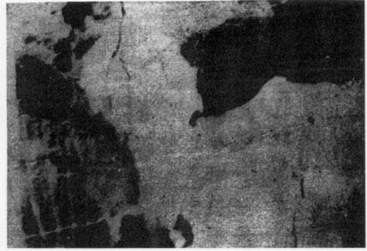

# BayesContourProcessing
Look at the image before reading on. Which patches belong to the same object? Where would you draw its outline?

Now look for a **cow’s face**. Once one patch reads as a muzzle, the patches around it can fall into place as parts of the same head. What did the cue contribute if the pixels stayed the same? Can knowing that a patchy image shows a cow change which marks you group into its muzzle? [Dallenbach’s cow puzzle (1951)](https://doi.org/10.2307/1419008)
This project studies a tractable part of these questions. People and a Bayesian model are tasked to reconstruct the six features of a masked, noisy drawing. Visibility, pixel flips, learned expectations and correct or misleading hints can all be varied to make an accurate reconstruction easier or more challenging.

## Brief Conceptual Overview: how evidence and expectation combine

How specific does the cue need to be? “Cow” suggests a familiar combination of features. “Muzzle nose” makes a claim about one part. Revealing the nose outline gives the observer a way to check that claim.

In the model, the visible pixels $I$ and the hints $H$ provide independent evidence given a candidate face $C$ and a known visibility mask $M$.

$$
P(C \mid I,M,H) \propto P(I \mid C,M)\,P(H \mid C)\,P(C).
$$

The **prior** captures which face recipes are familiar. The **image likelihood** scores how well each recipe predicts the visible strokes and visible background, allowing for noise. The **hint likelihood** accounts for what the observer was told and how reliable it is. Together they give a **posterior** over possible completions. If two recipes differ only behind the mask, the visible pixels give them equal support. Familiarity and hints can still favor one over the other.

## Resources

| Start here | Contents |
| --- | --- |
| [Try the two-tone animal puzzle](outputs/grayscale_animal_faces/pelican_demo/quantized.png) · [Reveal the four stages](outputs/grayscale_animal_faces/pelican_demo/how_it_was_made.png) · [Individual images](outputs/grayscale_animal_faces/pelican_demo/) | The [portrait processing script](computationalExperiments/recovery_from_grayscale_quantization/make_animal_face_stimuli.py) combines a transparent face with a [grayscale background](computationalExperiments/recovery_from_grayscale_quantization/grayscale_fields.py) and applies the [quantizer](computationalExperiments/recovery_from_grayscale_quantization/grayscale_regions.py). Reproduce the demo from the project root with `python -m computationalExperiments.recovery_from_grayscale_quantization.make_animal_face_stimuli`. |
| [Poster](Poster/Bayesian_Visual_Contour_Poster_24x36.pdf)  | My poster for the undergraduate Berkeley Neuroscience senior poster session.   |
| [Writeup](writeup/closure_experiment.pdf) · [LaTeX](writeup/closure_experiment.tex) | Current 729-recipe design, equations, prior-learning methods, results and encoder proposal. The source figures are beside the TeX file in [figures](writeup/figures/). |
| [Baseline notebook](computationalExperiments/face_completion/face_completion_counted_priors.ipynb) · [baseline guide](BASELINE.md) | Counted priors, pixel and vector evidence, full-candidate and iterative inference. [Saved runs](outputs/) include the November 16 visibility, targeted-cue and mixed-cue experiments. |
| [Prior-learning guide](PRIOR_LEARNING.md) | Executed notebooks for [supervised Hebbian](computationalExperiments/prior_learning/supervised_hebbian_category_learning.ipynb), [competitive Hebbian](computationalExperiments/prior_learning/competitive_hebbian_category_learning.ipynb) and [Hopfield](computationalExperiments/prior_learning/hopfield_exemplar_memory.ipynb) learning. [Results](outputs/) include weights, matched comparisons and capped-noise sweeps. |
| [Human study guide](psychophysicalExperiments/README.md) · [Windows launcher](psychophysicalExperiments/Start%20face%20study.cmd) | Desktop and [live browser experiment](https://thomylee2501.github.io/Bayesian-Interpretation-on-Visual-Contour-Processing/) ([browser source](psychophysicalExperiments/web/index.html)), response files, feedback images, session schedules and analysis tools. |
| [Daily project log](PROGRESS.md) | Traces the work progress from the cow photograph through the pilot results and includes the chat diagrams. |

## Working from this directory

| To answer this question | Open this folder |
| --- | --- |
| How do image evidence, priors, and hints affect face reconstruction? | [Face completion experiments](computationalExperiments/face_completion/) |
| How does the model learn a prior? | [Prior learning notebooks](computationalExperiments/prior_learning/) |
| How are faces rendered and scored? | [Shared model code](contour_models/) |
| How do I regenerate or execute a notebook? | [Notebook tools](tools/notebooks/) |
| Where do participant sessions and model replays start? | [Human study guide](psychophysicalExperiments/README.md) |
| Where are the numerical and information-leakage checks? | [Tests](tests/) |

Open [Recovery from grayscale quantization](computationalExperiments/recovery_from_grayscale_quantization/recovery_from_grayscale_quantization.ipynb) to see how gray-bin placement and lighting affect the grouping of two lobes. Under **Set up the signal**, edit `manual_scene()` to place lobes, choose their shapes and bridges, and set their brightness relative to the local background. The preview shows which edges survive quantization. The held-out probabilities come from the seeded two-lobe benchmark. To refit from the project root, run `python -m computationalExperiments.recovery_from_grayscale_quantization.run_grouping_experiment`, then run the notebook for the plots. [Saved measurements](outputs/recovery_from_grayscale_quantization/held_out_summary.csv) include the 64, 128, and 256 pixel conditions. For the filenames printed in the November writeup, see the [source tree used for that version](https://github.com/ThomyLEE2501/Bayesian-Interpretation-on-Visual-Contour-Processing/tree/dd52ae9cfbb52e443c931c747206816a57466ff9).

Open a working notebook from its experiment folder in Jupyter. The baseline notebook uses batch counting. The [full learned-prior notebook](computationalExperiments/face_completion/face_completion_learned_priors.ipynb) defaults to supervised Hebbian learning and exposes the competitive and Hopfield settings. To run a notebook from a terminal, use `python tools/notebooks/execute_notebook.py computationalExperiments/face_completion/face_completion_counted_priors.ipynb` from the project root. The `build_*.py` tools replace their corresponding notebook with an unexecuted copy. With the [dependencies](requirements.txt) installed, run the test suite from the project root.

~~~powershell
python -m unittest discover
~~~

All saved runs live under [outputs](outputs/). The [baseline](outputs/baseline/) and [learned-prior](outputs/learned_priors/) benchmark folders each contain their own metrics, figures and run summary. Named experiment folders hold the sweeps and prior comparisons. [Psychophysics](outputs/psychophysics/) holds the participant sessions and accuracy plots. [Poster data](outputs/poster/) holds the recovery sets and plotted series.

## Which results were kept

The saved [baseline benchmark](outputs/baseline/benchmark.csv) used renderer version 1. The current baseline notebook uses version 2, which adjusts the dot-eye positions. To reproduce the archived CSV, pass `renderer_version=1` to `make_library` in the baseline notebook's library setup cell. The [learned-prior benchmark](outputs/learned_priors/benchmark.csv) uses version 2.

For each experiment, the collection keeps the latest saved run, its inputs or configuration, figures, tables and executed notebooks. The November 16 eye-shape runs replace the November 13 versions. The capped-noise and high-visibility runs cover different conditions, so both are present. The [poster](Poster/Bayesian_Visual_Contour_Poster_24x36_Hint_Results_Merged_Plots_Fitted.png) uses set 06 of the seven [sampled recovery examples](outputs/poster/Face_Recovery_Sets/).

The two complete pilot sessions each have 50 responses. The two partial sessions have five and two confirmed responses. The raw session folders stay local under `outputs/psychophysics/participant_sessions/`. The poster pools the complete sessions and applies its two-trial exclusion only to the analysis. The [pooled plot data](outputs/poster/plot_data/human_scatter_data.json) contain the 98 trials used in the poster.
